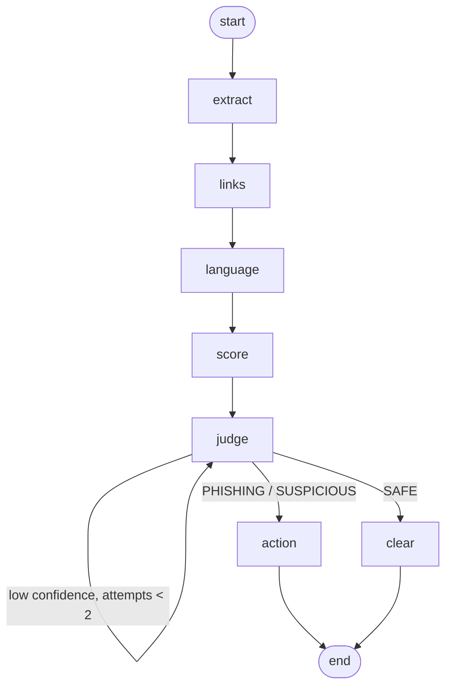

# 🛡️ Phish Shield - LangGraph Phishing Investigator

Paste a suspicious email/SMS. A **LangGraph** agent extracts evidence, scores it with a rule engine,
asks Gemini to judge, **re-checks itself when unsure**, then returns a verdict and a protection plan.

## LangGraph workflow

| Node | What it does |
|---|---|
| extract | pulls URLs out of the message |
| links | flags raw-IP hosts, `@` tricks, punycode, shorteners, risky TLDs, brand impersonation & typo-squats |
| language | detects urgency, credential requests, money lures, generic greetings, sender/brand mismatch |
| score | combines evidence into a 0-100 rule score |
| judge | Gemini returns verdict + confidence + reasoning (offline fallback = rule verdict) |
| action / clear | personalised protection plan, or an all-clear note |

| Item | Value |
|---|---|
| LLM | Gemini (`gemini-3.8-flash`, override with `GEMINI_MODEL`) |
| Framework | LangGraph (`StateGraph`, conditional edges, self-loop) |
| RAG | not used - rule-based tools + LLM reasoning |
| UI | Streamlit |

## Run in Google Colab
Open `PhishShield_Colab.ipynb`, (optionally) add `GEMINI_API_KEY` under 🔑 Secrets, run all cells.

## Run locally
```bash
pip install -r requirements.txt
export GEMINI_API_KEY=your_key      # optional - works offline without it
streamlit run app.py
```
Tests: `python -m pytest -q tests`

## Deploy on Render (free)
Push to GitHub → Render **New → Web Service** → pick the repo (uses `render.yaml`) → add `GEMINI_API_KEY` → Deploy.
